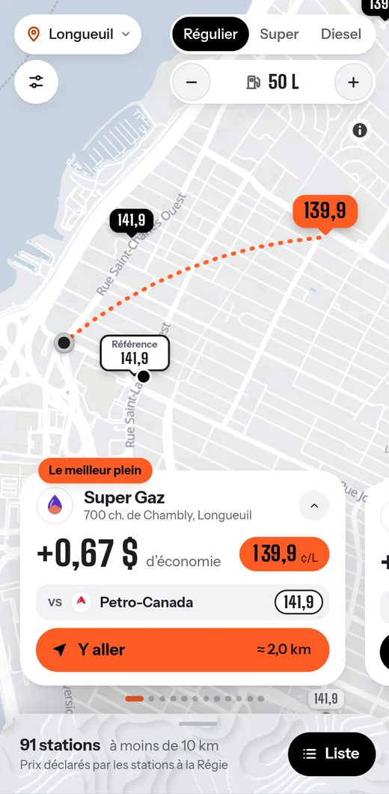
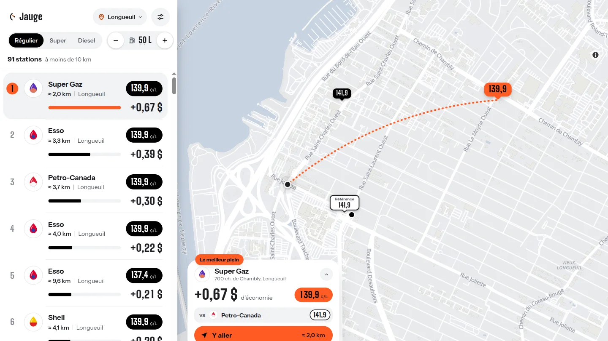
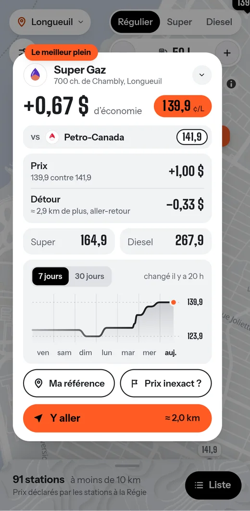
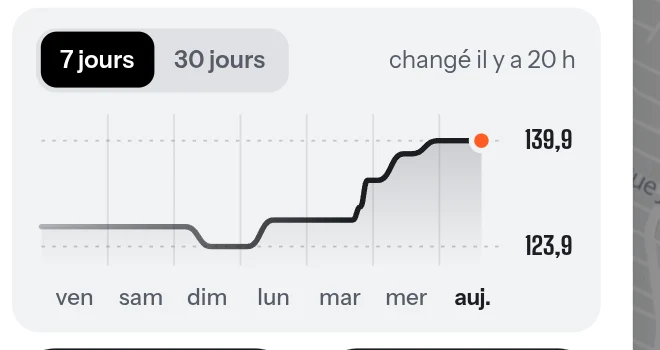
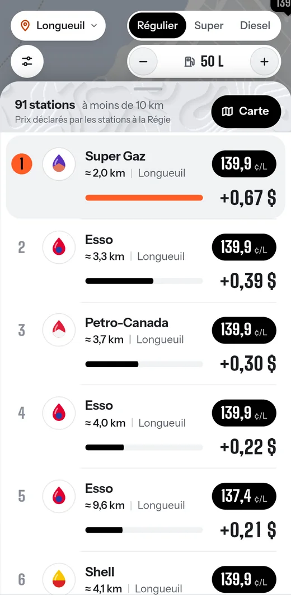
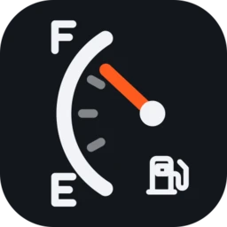

# Design System: Jauge

This file describes how Jauge looks. How it behaves (what a tap does, how savings are calculated, what the map shows at each zoom) is in [`docs/design/behaviour.md`](docs/design/behaviour.md). What the product is and for whom is in [`PRODUCT.md`](PRODUCT.md).

The design was worked out in mockups, which are kept in `src/prototype/main-screen-fable/` (variant B3). Where this file and the mockup disagree, this file wins.

## Overview

**Creative North Star: "The price sign and the road"**

Everything comes from what you actually look at when you buy gas in Quebec: the black price sign on its pole with tall narrow numerals, the pump with its grade buttons and rolling figures, grey asphalt and concrete, and one orange traffic cone. The map is the screen. Prices sit on it as small black signs. One station is orange: the one worth going to.

The interface is quiet so the answer can be loud. There is almost no explanatory text. A control must be understood from its shape, its icon and where it sits, the way a pump or a dashboard is understood.

Rejected on purpose: frosted glass panels, a card for every figure, cream backgrounds with terracotta, labels in capital letters above headings, strings of facts joined by middle dots, price colour-coding from green to red, and any sentence that tells the person what to do.

**Key characteristics:**

- A pale, cool map where the roads are the brightest thing.
- True black price signs in a tall, narrow numeral face.
- One accent, used only for the best option and the main action.
- Numbers roll like a pump display when they change.
- Sentence case everywhere. Icons before words.

## Colors

Cool greys taken from concrete and asphalt, true black for signs, and one orange. The names are French because the things are.

### Primary

- **Cône** (`cone`): the only accent. It marks the best fill-up (its map sign, its card label, its price, its bar in the list), the main action ("Y aller" on the best card, "Autour de moi"), the needle of the icon, and the "now" dot of the price chart. Text on it is black (`sur-cone`).
- **Cône encre** (`cone-encre`, `nuit-cone-encre` in dark): the same orange darkened or lightened so small orange marks stay readable on the surface. Used for small icons such as the place pin.

### Neutral

- **Béton** (`beton` / `nuit-beton`): the page behind everything, and the welcome screen.
- **Papier** (`papier` / `nuit-papier`): anything raised: cards, sheets, chips, the list.
- **Papier 2** (`papier-2` / `nuit-papier-2`): an inset inside a raised thing: the comparison row in a card, the chart block, a search field, a segmented control's track.
- **Asphalte** (`asphalte` / `nuit-asphalte`): text and icons.
- **Gravier** (`gravier` / `nuit-gravier`): secondary text. This is the lightest grey allowed for text.
- **Gravier pâle** (`gravier-pale` / `nuit-gravier-pale`): placeholders and decorative marks only. It fails 4.5:1 on Papier, so it never carries information.
- **Enseigne** (`enseigne` / `nuit-enseigne`): price signs and the selected state of switches. True black in light mode; near-white in dark mode, where the roles flip.
- **Carte** (`carte-terre`, `carte-eau`, `carte-route` and their `nuit-` versions): the map's land, water and roads. The map is recoloured to these; the map provider's own colours are never shown.

### Named Rules

**The One Cone Rule.** Orange means "the best one" or "the main thing to do here". If a screen shows orange in a third meaning, remove it.

**The No Traffic-Light Rule.** Prices are never coloured from green to red. Cheap and expensive are shown by rank, by the savings amount and by the length of a bar.

**The Flip Rule.** In dark mode the sign colour becomes light and its text black. Do not keep black signs on a dark map.

## Typography

**Numbers and display:** Big Shoulders (variable, 100 to 900), then Instrument Sans.
**Everything else:** Instrument Sans (variable), then the system sans.

**Character:** Big Shoulders is tall and narrow like the numerals on a price pole and on highway signs. It is used very heavy when small and can go very light when huge. Instrument Sans is quiet, slightly narrow, and handles French accents well.

### Hierarchy

- **Display** (`display`, `display-thin`): the welcome screen only. Three stacked lines, thin, heavy, thin: "Le plein / moins cher, / détour compris."
- **Amount** (`amount`): the savings on a card. 28 px when the amount has more than five characters.
- **Price** (`price`): a price inside a sign or pill, always followed by a small "¢/L". 15 px on map signs, 20 to 21 px in pills.
- **Title** (`title`): a station's name.
- **Body** (`body`): buttons and inputs.
- **Secondary** (`secondary`): addresses, distances, the words beside an amount.
- **Caption** (`caption`): labels on small tags, chart axes, the source line. Nothing is smaller than this.

The working scale is 12, 14, 16, 20, 28 px. Sizes between two steps exist only for numbers in Big Shoulders.

### Named Rules

**The Sign Rule.** A price is written the way the station's sign writes it: `171,9` then `¢/L` (`171.9` in English), with tabular figures. Never `1,719 $`.

**The Sentence Case Rule.** No capital-letter labels, no letter-spaced captions, no label sitting above a heading.

**The Rolling Rule.** A number that changes because of something the person did (litres, fuel, reference) rolls digit by digit like a pump display. Text never rolls.

## Layout

**Phone.** The map fills the screen. Three layers sit on it:

1. Top: the place chip and the settings button on the left; the fuel switch with the litres control under it on the right. 14 px from the edges.
2. Bottom: a row of station cards, 326 px wide with 10 px between them, the next one peeking in from the right. Page dots under the row.
3. Under the cards: an 80 px strip with the station count, the source line and the "Liste" button. Dragging it up, or pressing the button, opens the full list over the map, leaving the top controls visible.

The map keeps the selected station and the starting point clear of these layers.

**Wide screens.** A 420 px panel on the left holds the name, the same controls, and the full list, with the source line pinned at its bottom. The map takes the rest. The selected station's card is docked at the bottom left of the map, 360 px wide. Place search and settings open as a second panel beside the list. Nothing dims the map.

**Spacing.** Multiples of 4 px. 8 px between related items, 12 px between groups inside a card, 16 px of padding inside cards, 20 px inside sheets.

**Touch.** Every control is at least 44 px tall or has a 44 px hit area. Smaller-looking controls (the 26 px card labels, the 38 px stepper buttons) extend their hit area invisibly.

## Elevation & Depth

Depth says "this floats over the map". Two shadows exist, plus flat insets. A raised thing never also has a border.

### Shadow Vocabulary

- **Low** (`0 1px 1px rgba(20,23,28,.06), 0 6px 16px -6px rgba(20,23,28,.18)`): chips, the fuel switch, card labels, area bubbles.
- **High** (`0 2px 2px rgba(20,23,28,.05), 0 22px 44px -18px rgba(20,23,28,.38)`): station cards, panels, the "Chercher ici" pill.
- **Sign** (`0 3px 8px -2px rgba(0,0,0,.35)`): price signs on the map.
- In dark mode the same roles use darker, wider shadows with a faint light line along the top edge (`0 1px 0 rgba(255,255,255,.05) inset`).

### Named Rules

**The No Glass Rule.** Surfaces over the map are solid. No blur, no translucency.

**The Outline-Is-A-State Rule.** A 1.5 to 2 px Asphalte outline means "this is the reference" (its map sign, its card label, its price pill, its list tag) or "an unselected choice" (an outlined button). It is not decoration.

## Shapes

Three families, each with a meaning:

- **Pills** (fully round): things you press and things that are a single value: buttons, chips, switches, price pills, card labels.
- **Soft rectangles**: containers. Cards 26 px, sheets 28 px on their free corners, blocks inside a card 13 to 14 px.
- **Signs**: map price signs, 9 px corners with a small pointer underneath, like a tag pinned to the spot. Stations without a card get a smaller, pointer-less tag floating over their dot.

The topographic relief (soft embossed contour lines) is the only texture. It appears behind the welcome screen and behind the list's header strip, nowhere else.

Brand badges are round. Until real logos are added, each banner has a placeholder: a fuel drop in the banner's usual two colours inside a white disc. Never initials.

## Components

### Price signs (map)

- **With a card** (`price-tag`): Enseigne background, the price in Big Shoulders, pointer underneath. The best one is Cône (`price-tag-best`). The selected one is 1.38 times larger.
- **Reference**: Papier background, 2 px Asphalte outline, the word "Référence" above the price.
- **Without a card** (`price-tag-quiet`): small Papier tag with Gravier numbers over the station's grey dot. Shown only when zoomed in.
- **Area and region bubbles**: Papier, Low shadow, a place name in Caption over its lowest price. Shown when zoomed out.
- When two signs would overlap, the less important one shrinks to a dot. Importance: selected, best, reference, rank, then cheapest.
- Signs drop in once when the map first appears, nearest first. After that they only move with the map.

### Station card

- **Folded**, top to bottom: brand badge, name and address with a round chevron; the savings amount beside the price pill; one comparison row; the "Y aller" button with the distance inside it.
- **Label** on the top edge, left: "Le meilleur plein" (Cône) or "Ta référence" (outlined, with a small × when the person chose it).
- **Way back**, top edge, right: an orange "Meilleur plein" pill on any selected card that is not the best.
- **Unfolded**: the card grows upward in place. Under the comparison row appear where the savings come from (price difference, detour), the other two fuels, the price chart, then "Ma référence" and "Prix inexact ?". "Y aller" stays at the bottom. The chevron turns.
- **Motion**: 0.42 s, `cubic-bezier(.16, 1, .3, 1)`, the content fading in just after. Neighbouring cards are 94% scale; on a phone they fade out and the map dims while a card is unfolded.
- The best card's "Y aller" is Cône (`button-go`); every other card's is Enseigne (`button-go-quiet`).

### Price chart

- A smooth line: flat while the price holds, a short soft ramp at each change. It never rises above or dips below a real price.
- 3 px Asphalte line that fades toward the past; the area under it fades to nothing; a Cône dot with a ring marks now.
- Two dotted levels, the highest and lowest price of the period, labelled on the right. Day lines and weekday labels underneath (dates for 30 days).
- A "7 jours / 30 jours" switch on the left. On the right, when the price last changed. Sliding a finger or the mouse along the chart moves the dot and replaces that text with the price and time under the finger.
- The line draws itself once when the card unfolds.

### Buttons

- **Main** (`button-go`): Cône pill, 44 px in cards, 52 to 56 px in sheets and on the welcome screen. Pressed: scales to 95%.
- **Quiet main** (`button-go-quiet`): same shape in Enseigne.
- **Outline** (`button-outline`): 1.5 px Asphalte outline. Selected: filled Enseigne. Used for "Ma référence" and "Prix inexact ?".
- **Round**: 44 px Papier circle with one icon (settings, close).
- **Focus**: 2 px Cône outline, 2 px offset, on every control.

### Chips and switches

- **Place chip** (`chip`): pin or target icon, the place name, a small down arrow. Opens the place search.
- **Fuel switch**: three words in a Papier pill; the selected one sits on an Enseigne thumb that slides between them.
- **Litres stepper**: minus, a pump icon with the number and "L", plus. The number rolls.
- **Segmented control**: Papier 2 track, selected option on Enseigne. Used in settings and on the chart.
- **Car size**: three line drawings of a small car, a car and a truck. Each stands for a range of consumption; the highlighted one follows the number.

### List rows

Two lines per station: rank, badge, name, distance and town, price pill; under them a bar whose length is the savings, and the signed amount. The best row has a Cône rank and bar. The reference row shows an outlined "Référence" tag instead of an amount. The selected row sits on Papier 2. In an overview (see behaviour), rows are a single line with no bar and no amount.

### Sheets and panels

On a phone, a sheet rises from the bottom over a 42% black scrim, with a grab handle and a round close button; dragging it down closes it. On wide screens the same content is a floating panel beside the list, with no scrim.

### Icons

Drawn as 1.7 px rounded strokes on a 16 or 18 px grid, in the text colour. No emoji, no typed symbols standing in for icons.

The app icon is an upright fuel gauge: F on top, E at the bottom, an orange needle, a small pump (`public/icon.svg`). Beside the name it is reduced to the arc and the needle.

### Motion, in general

- Things that follow the finger use springs (stiffness about 330, damping about 34) and keep their momentum on release.
- One opening moment: on first open, the three title lines rise in turn, then the buttons.
- Nothing else moves by itself.
- With reduced motion, every movement becomes an instant change or a fade.

## Do's and Don'ts

### Do:

- **Do** keep orange for the best option and the main action only.
- **Do** write prices as `171,9 ¢/L` in Big Shoulders with tabular figures.
- **Do** make every control explain itself with an icon and a familiar shape.
- **Do** keep the source line ("Prix déclarés par les stations à la Régie") visible on the main screen at all times.
- **Do** give every pressable thing a 44 px hit area and a visible focus ring.
- **Do** let a changed number roll, and let a changed layout move with a spring.
- **Do** check both themes; in dark mode signs are light with black text.

### Don't:

- **Don't** add instruction or hint text ("tap here", "swipe to see more").
- **Don't** colour prices green, yellow or red.
- **Don't** use frosted glass, blur, or see-through panels over the map.
- **Don't** put a border and a shadow on the same surface.
- **Don't** write labels in capital letters or join facts with middle dots.
- **Don't** use Gravier pâle for text that carries information.
- **Don't** draw a curve through prices that never existed; the chart's ramps connect real prices only.
- **Don't** cover the list or the selected card with another panel on wide screens.
- **Don't** show a brand as initials, or alter a real logo.
