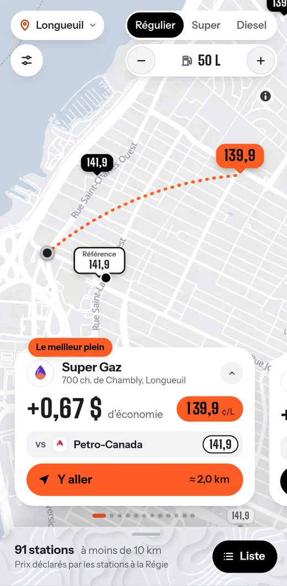
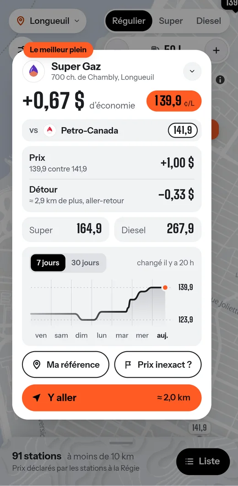
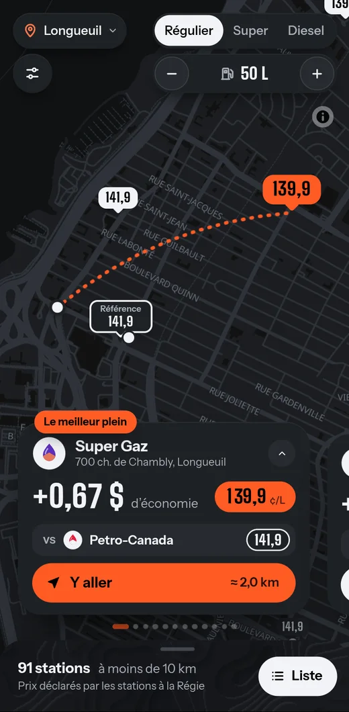

# Jauge

Where to fill up in Quebec, ranked by what you really save.

Most gas-price apps sort stations by price. Jauge sorts them by **real savings**: what you save on your fill-up compared with the station you would have gone to anyway, minus what the extra driving costs. A station that is 3 cents cheaper but 12 km away can cost you money, and Jauge says so.

Prices come from the [Régie de l'énergie](https://regieessencequebec.ca), to which every Quebec station must report its own prices. Jauge shows them as published.

<p>
  
  
  
</p>

## Status

**Design is done and prices are being collected; the app is not built yet.** This repository currently holds:

- the design documentation;
- working mockups of every screen, with real station data and invented price history;
- the job that fetches the Régie's prices every few minutes and records each change (its output is on the [`data` branch](../../tree/data)).

Next: the app itself.

## Documentation

| File | What it covers |
|---|---|
| [`PRODUCT.md`](PRODUCT.md) | What Jauge is, who it is for, what is decided and what is open |
| [`DESIGN.md`](DESIGN.md) | How it looks: colours, type, shapes, components, rules |
| [`docs/design/behaviour.md`](docs/design/behaviour.md) | How it behaves: savings, reference station, map, cards, settings |
| [`docs/data.md`](docs/data.md) | Where the prices come from, what the collecting job saves, and the file formats |
| [`GLOSSARY.md`](GLOSSARY.md) | The words used in the code, the interface and the docs |
| [`docs/adr/`](docs/adr) | Decisions that are hard to undo, and why they were made |

## Try the mockups

You need Node 22 or newer.

```sh
npm install
npm run dev
```

Then open `http://localhost:5173/fable.html`. The bar at the bottom of the page switches between the mockup variants, light and dark, phone and wide screen. Variant **B3** is the chosen design; the others are earlier directions kept for reference.

The mockup code in `src/prototype/` is throwaway. It exists to answer design questions and will not become the app.

## Built with

React, TypeScript, Vite, [Motion](https://motion.dev) and [MapLibre](https://maplibre.org), with map tiles from [OpenFreeMap](https://openfreemap.org) (© OpenStreetMap contributors). Typefaces: Big Shoulders and Instrument Sans.

## Data and credit

Station names, addresses and prices are published by the Régie de l'énergie du Québec. Jauge is not affiliated with the Régie. If a price is wrong, it has to be corrected at the source: report it to the Régie.

## Licence

[MIT](LICENSE). Brand logos, when they are added, are the property of their owners and are not covered by this licence.
