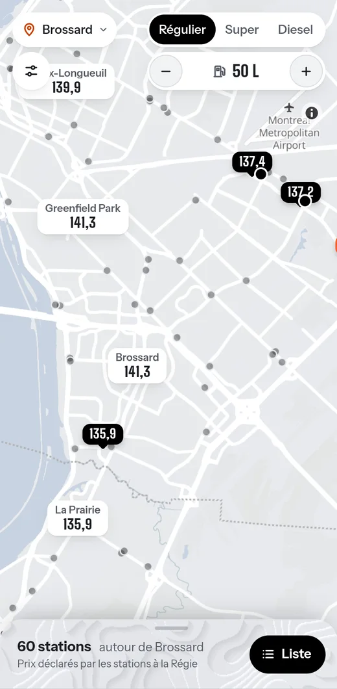
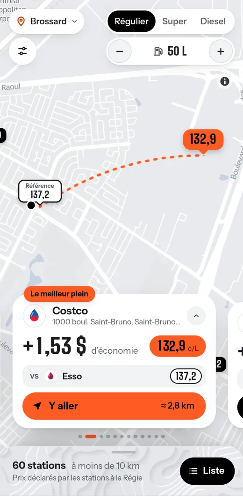
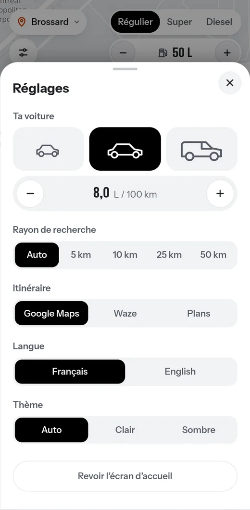
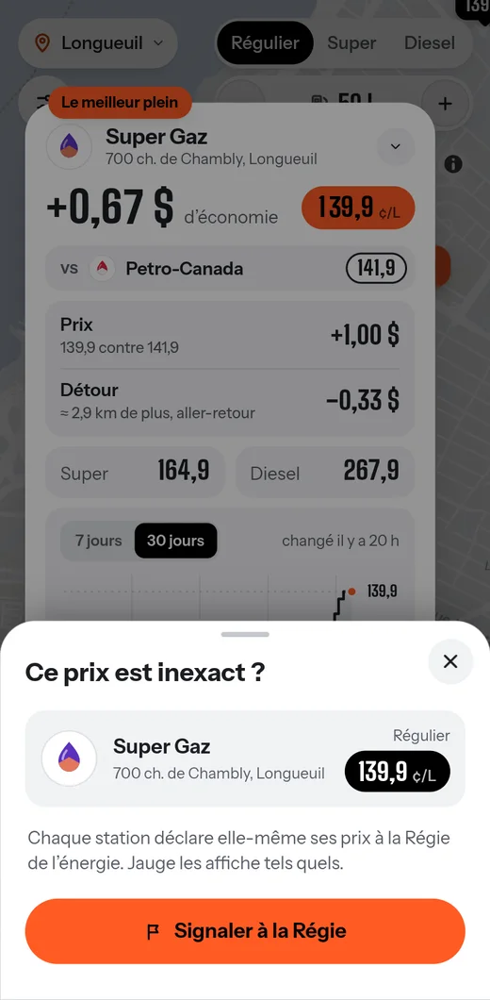
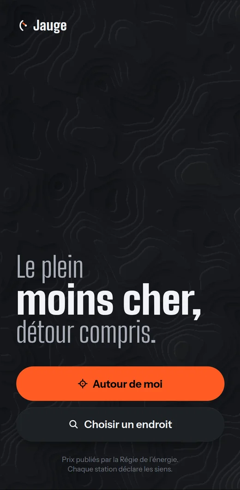
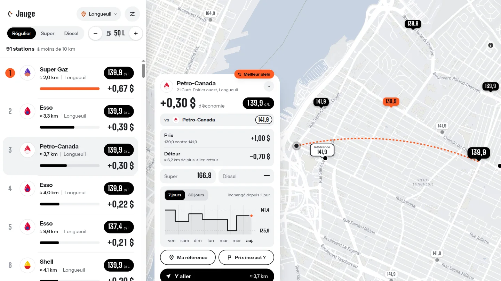

# How Jauge behaves

This is the companion to [`DESIGN.md`](../../DESIGN.md). That file says how things look; this one says what they do. Words in **bold** on first use are defined in [`GLOSSARY.md`](../../GLOSSARY.md).

Every rule here was tried in throwaway mockups and agreed with the project owner in November 2026. The screenshots come from those mockups. The last section lists what the app still approximates.

## The screens

| Screen | What it is for |
|---|---|
| First open | Says what Jauge does and asks where to look |
| Main screen | The map, the best stations as cards, the full list |
| Unfolded card | One station's details, in place |
| Place search | Look somewhere else |
| Settings | Your car, your radius, your preferences |
| Report a price | Tell the Régie a price is wrong |

There is no separate station page and no navigation bar. Everything happens on the main screen.

## Real savings

For the chosen **fuel type**, every station is compared with the **reference station**:

```
price saving = (reference price − station price) × fill volume
detour cost  = extra distance × 2 × consumption × reference price
real savings = price saving − detour cost
```

- *Extra distance* is how much farther the station is than the reference, never less than zero. It is counted there and back.
- Distance is the straight line multiplied by 1.3, and is always shown with "≈".
- Defaults: 50 L, 8 L/100 km.
- Real savings can be zero or negative. A negative amount is written as a cost: "12,06 $ plus cher", not "−12,06 $ d'économie". The list keeps short signed amounts.
- Stations within the **search radius** are ranked from the highest real savings down. The radius is 10 km, widened to 25 km when fewer than five stations are found, unless the person sets it.

The best-ranked station is the **best fill-up**. It is the one orange thing on the screen.

## Reference station

The reference is the station the person would have gone to anyway.

1. By default it is the closest station that sells the chosen fuel.
2. The person can pick another one. Tapping a station that has no card (a grey dot, a light price tag, or a list row outside the first twelve) makes it the reference. So does "Ma référence" in any unfolded card.
3. A picked reference goes to the front of the cards with a "Ta référence ×" label. Its comparison row names the best fill-up and what it would save ("meilleure option +1,53 $"), or says "Rien de mieux autour". The × returns to the default.
4. Tapping a station that already has a card only brings that card forward. It does not change the reference.

Everything recalculates against the reference at once: cards, list, map.

The reference is always marked: an outlined "Référence" sign on the map, an outlined label and price on its card, an outlined tag in the list. Every other card says what it is compared with ("vs Petro-Canada 141,9"); tapping that row goes to the reference.

## Position and place

Jauge never pretends to know where the person is.

**With a position** ("Ma position", from the device): the map shows a dot where the person is. Distances and detours start there.

**With a place chosen by hand** (from the search, or "Chercher ici"): there is no dot and no ranking at first. The person sees an **overview**:



- the map fitted to the place;
- every station's price (the few cheapest get the solid signs);
- the list sorted by posted price, one line per station;
- no cards.

Tapping a station there makes it the **starting point**: it becomes the reference, and distances and savings are calculated from it as if the person were standing there. The cards appear. The × on "Ta référence" returns to the overview. Tapping another station without a card moves the starting point to it.



"Chercher ici" appears when the person has moved the map until their own spot has left the screen. It opens an overview of what they are looking at.

If the device refuses to give a position, the place search opens.

## The map

What the map shows depends on how far out it is zoomed:

| Zoom | Stations with a card | Other stations |
|---|---|---|
| Close | Solid price signs | Light price tags over their dot |
| Middle | Solid price signs | Dots, plus one bubble per town or neighbourhood with its lowest price |
| Far | Hidden | One bubble per administrative region with its lowest price |

- The neighbourhood, town and region of a station must come from official boundaries. (The mockup approximates this; see the last section.)
- Tapping a bubble flies to the cheapest station in that area.
- The person's own best stations keep their signs and win the space; a bubble that would cover them is hidden.
- When the selection changes, the map moves to show both the starting point and the selected station, with a dotted line between them, clear of the cards and controls.
- The map is never rotated or tilted.

## Cards

The cards are the twelve best-ranked stations, best first, plus the reference if it is not among them.

- Swiping the row, tapping a neighbour, tapping a sign on the map and tapping a list row all select a station. The map follows.
- Tapping the name row of the selected card unfolds it in place. Tapping it again, pressing Escape, or (on a phone) tapping outside folds it.
- Every card is the same height when folded: name, amounts, one comparison row, "Y aller".
- A selected card that is not the best shows an orange "Meilleur plein" shortcut. The best station's page dot is orange.
- "Y aller" opens directions in the person's maps app. The first time, it asks which one (Google Maps, Waze, Apple Plans); the answer can be changed in settings.

Unfolded, a card adds:

1. **Why this amount**: the price difference and the detour, as two lines.
2. **The other two fuels** at that station.
3. **The price chart**: 7 days by default, 30 on request. Every price change shows, including several in one day. Sliding along the chart reads the price at any moment.
4. **"Ma référence"**: makes this station the reference, or releases it.
5. **"Prix inexact ?"**: opens the report sheet.

## The list

- Shows every station in the radius, ranked, two lines each, with a bar for the savings.
- On a phone it is a strip under the cards that opens over the map, by dragging or with "Liste". The top controls stay visible. Opening it shows rows immediately.
- Tapping a row selects that station and closes the list. Tapping the row that is already selected unfolds its card.
- The strip always shows the station count and the source of the prices.

## Top controls

- **Place chip**: where the person is looking. Opens the place search ("Ma position", then places).
- **Fuel**: Régulier, Super, Diesel. One at a time. These are the three grades the Régie publishes, under these names (its "super" is 91 octane; mid-grade 89 and 94 are not published). The switch shows the words only: octane numbers under them were tried and made it cramped and uneven beside Diesel.
- **Litres**: 10 to 120, in steps of 5. It is one setting for the whole app, so it lives at the top, never on a card.
- **Settings**.

Changing fuel or litres updates every amount in place; numbers roll.

## Settings



- **Ta voiture**: three drawings, each a range of consumption (up to 7, 7.5 to 9.5, 10 and more, in L/100 km), plus a stepper for the exact number in steps of 0.5. The highlighted drawing follows the number.
- **Rayon de recherche**: Auto, 5, 10, 25, 50 km.
- **Itinéraire**: which maps app "Y aller" opens.
- **Langue**: Français, English.
- **Thème**: Auto (follows the device), Clair, Sombre.

## Reporting a wrong price

"Prix inexact ?" opens a small sheet showing the station, the fuel and the price, one sentence saying that stations report their own prices to the Régie, and a button that opens the Régie's site.



The Régie's site has no page per station and no form another site can submit to. Its own report button writes an e-mail to its enquiries address with the station's details filled in. Writing the same e-mail from Jauge was tried and set aside for now; it remains an option.

## First open



Shown once. The name, three lines saying what Jauge does, two buttons ("Autour de moi", "Choisir un endroit"), and the source of the prices.

## Wide screens



- The list is always visible on the left. Nothing ever covers it.
- The selected station's card is docked at the bottom left of the map and unfolds upward in place. The map shifts to the free space. Nothing dims.
- Place search, settings and the report sheet open as a second panel beside the list.
- Clicking another row while a card is unfolded switches to that station and keeps it unfolded.

## Words

- French first, informal ("tu"). English follows the device language.
- No instruction text anywhere.
- An action keeps one name everywhere: "Y aller", "Ma référence", "Meilleur plein", "Prix inexact ?".
- The source line is "Prix déclarés par les stations à la Régie de l'énergie" (shortened to "…à la Régie" where space is tight).

## Not designed yet

- Loading, empty and error screens (the mascot Gazou belongs here).
- A stale price marker (a posted price unchanged for three days or more).
- The English wording.
- The privacy note.
- Pull to refresh.
- What the chart shows before a week of history exists ("depuis le …").

## What the app still approximates

The app started from the mockups and is replacing their stand-ins one by one. Still to do:

| Today | Meant to be |
|---|---|
| A station belongs to the nearest place name shown on the map | Official neighbourhood, town and region boundaries |
| Place search only knows towns that have a station | A real place search (addresses, towns, postal codes) |
| Brand badges are coloured placeholders | Real logos for the ten largest banners |
| Route app, language and theme in settings do nothing; the theme follows the device | They work |
| "Y aller" opens Google Maps directly | Asks once which app |
| If our data cannot be reached, the app shows the snapshot shipped with the site | Falls back to the Régie's own feed when our data is more than an hour old |

Already replaced: prices come from our collector, the price chart draws recorded changes, nothing is ranked from an invented position, and the wide layout switches on by itself.
